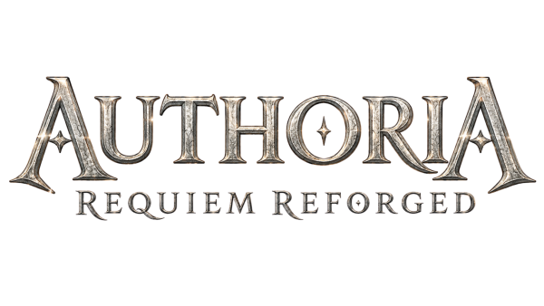

  

  The team behind the <strong>Authoria</strong> Skyrim Special Edition modlists, and the tools we build them with.

## Authoria – Requiem Reforged

A Wabbajack modlist built on Requiem and Legacy of the Dragonborn, with Seasons of Skyrim. It's survival-focused and
deliberately paced: hard progression, seasonal survival, dynamic encounters and an overhauled look.

**Current version: 2.9.10.**

| | |
|---|---|
| **Install** | Search for *Authoria* in the [Wabbajack](https://www.wabbajack.org/) app |
| **Guidebook** | [Installation, tools and gameplay guides](https://authoria-modding.github.io/Authoria-Requiem-Reforged/) |
| **Nexus** | [Authoria – Requiem Reforged](https://www.nexusmods.com/skyrimspecialedition/mods/170235) |
| **Discord** | [Support, bug reports and news](https://discord.gg/J6VkyeXDUv) |

## Repositories

| Repo | What it is |
|---|---|
| [`Authoria-Requiem-Reforged`](https://github.com/Authoria-Modding/Authoria-Requiem-Reforged) | The modlist's Wabbajack metadata, guides and the Guidebook site |
| [`authoria-requiem-skills`](https://github.com/Authoria-Modding/authoria-requiem-skills) | Claude Code skills that patch Requiem load orders through houseCARL |

Bug reports for the modlist go to our Discord, not to GitHub issues.
